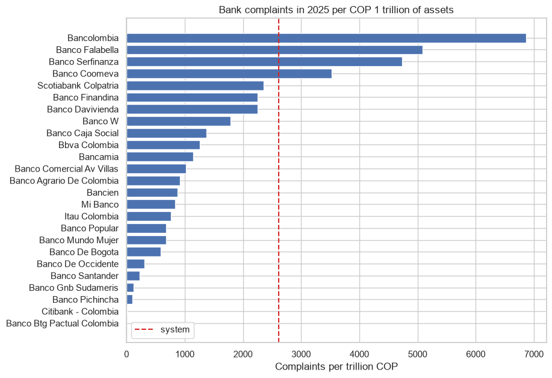
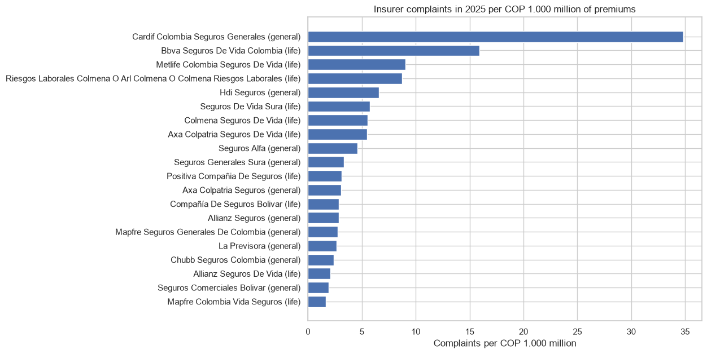

# Financial consumer complaints in Colombia

Which products and reasons generate more complaints against banks and insurers, and which entities have more complaints relative to their size.

## Data
Superintendencia Financiera (datos.gov.co): complaints 2023-2026 (`xyy7-rn7p`, 9.8 million), bank assets (CUIF) and insurance premiums (Formato 290).

## Main results
- 88% of the complaints are solved by the entity, only 6% go to the Superintendencia.
- Savings accounts, digital wallets and credit cards concentrate the complaints; the main reason is transactions the client does not recognise (fraud).
- Bancolombia has two thirds of all the bank complaints and also the highest rate: around 6.900 per COP 1 trillion of assets, 2.5 times the system.
- In insurance, bancassurance companies have the highest rates (Cardif: 35 complaints per COP 1.000 million of premiums, more than 10 times the median).




## How to run

```
pip install -r requirements.txt
jupyter notebook consumer_complaints.ipynb
```

---
Alejandro Lezcano Osorio | Universidad EIA (Colombia) and Rennes School of Business (France)
